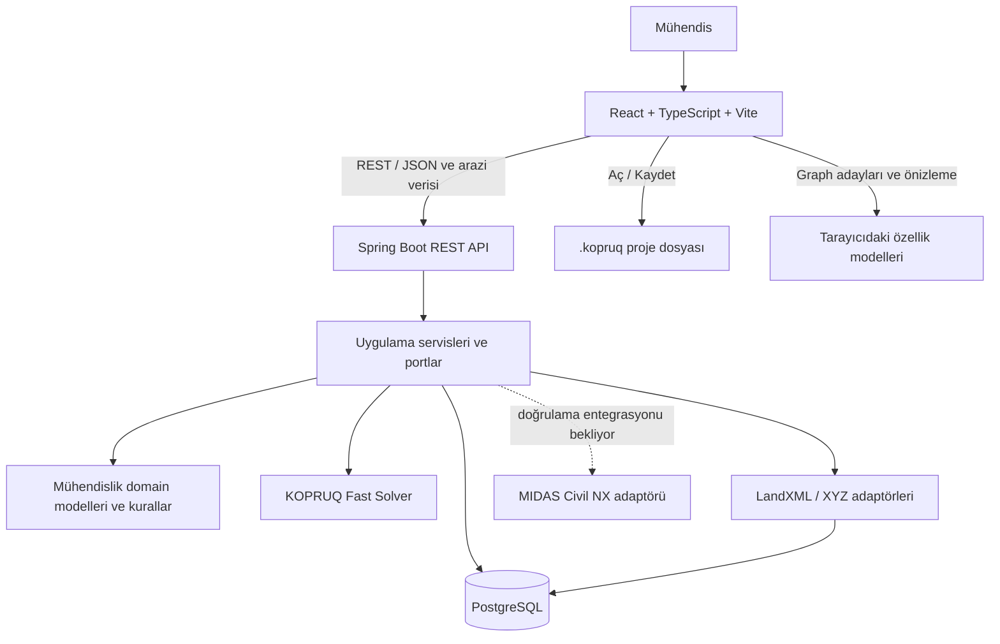
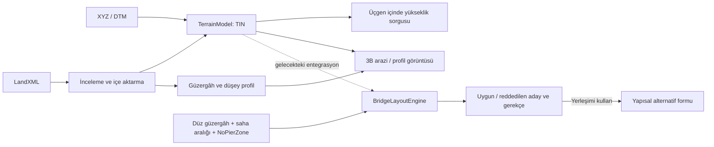
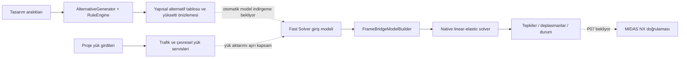
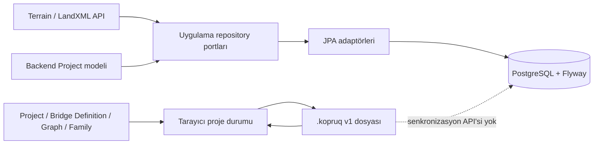

# KOPRUQ

**Köprü tasarımı için hesaplamalı ve üretken mühendislik platformu.** KOPRUQ; proje ve saha verilerini, köprü yerleşimi seçeneklerini, taşıyıcı sistem ailelerini, yükleri ve ön analiz sonuçlarını tek bir mühendislik iş akışında birleştirir. Amaç, mühendisin izlenebilir alternatifler üretip değerlendirmesidir. Harici çözücüler ve BIM araçları, KOPRUQ'nun kendi köprü modeline bağlanan adaptörlerdir.

> **Durum (Ekim 2026):** Bu depo etkin Java/React uygulamasıdır. `archive/` altındaki C#/.NET/Avalonia nesilleri yalnızca referanstır. Çalışan özellikler ile hedeflenen ancak henüz tamamlanmamış adımlar aşağıda ayrı gösterilir. Güncel kilometre taşı kaydı için [roadmap](docs/roadmap.md), uygulama geçmişi için [architecture](docs/architecture.md) dosyasına bakın.

## İçindekiler

- [Ürün ve mühendislik akışı](#ürün-ve-mühendislik-akışı)
- [Bugün neler çalışıyor?](#bugün-neler-çalışıyor)
- [Sistem mimarisi](#sistem-mimarisi)
- [Uçtan uca veri akışları](#uçtan-uca-veri-akışları)
- [Depo yapısı](#depo-yapısı)
- [Yerel çalıştırma](#yerel-çalıştırma)
- [Testler ve kalite kapıları](#testler-ve-kalite-kapıları)
- [Belgeler ve sınırlar](#belgeler-ve-sınırlar)

## Ürün ve mühendislik akışı

KOPRUQ'nun hedef iş sırası **Proje → Saha → Köprü yerleşimi → Taşıyıcı sistem → Analiz → Tasarım → Optimizasyon → Doğrulama → Teslim** şeklindedir. Aşağıdaki şemada kesintisiz oklar mevcut işlevleri, kesik oklar ise henüz tamamlanmamış bağlantıları veya gelecek aşamaları gösterir.

```mermaid
flowchart LR
    P[Proje ve köprü envanteri] --> S[Saha verisi: arazi ve güzergâh]
    S -. saha verisinden otomatik türetme bekliyor .-> L[Aday köprü yerleşimleri]
    L --> A[Yapısal alternatif üretimi]
    P --> F[Malzeme, yük ve yapı ailesi tanımları]
    F --> G[Graph ve Family adayları]
    A -. otomatik aktarım bekliyor .-> M[Ön analiz modeli]
    G -. mühendislik entegrasyonu bekliyor .-> M
    M --> N[KOPRUQ Fast Solver]
    N -. planlanan aşamalar .-> O[Optimizasyon ve Pareto]
    O -. planlanan aşamalar .-> V[MIDAS NX ile yüksek doğruluklu doğrulama]
    V -. planlanan aşamalar .-> D[BIM ve teslim çıktıları]
```



Bu şema bir tam otomasyon iddiası değildir: yerleşim sonucundan yapısal alternatif formuna bir seçim aktarımı vardır; arazi verisi henüz yerleşim motorunu sürmez. Fast Solver ayrı bir giriş/model kurma ve çözüm akışı olarak çalışır. Graph/Family adayları da bugün doğrulanmış analiz veya tasarım sonucu sayılmaz.

## Bugün neler çalışıyor?

| Alan | Mevcut kapsam | Sınır |
| --- | --- | --- |
| Proje çalışma alanı | Proje bilgileri, köprü envanteri, köprü tanımı; yerel `.kopruq` dosyasını açma/kaydetme, Graph ve aile verilerinin dosyaya alınması | Tarayıcıdaki proje dosyası akışı, backend `ProjectRepository` için bir REST kayıt akışı değildir |
| Saha ve güzergâh | XYZ/DTM ve LandXML içe aktarma, TIN arazi sorgusu, güzergâh/profil örnekleme ve 3B arazi görüntüleme | Araziye bağlı ayak/kenar ayak yerleşimi, uydu görüntüsü ve koridor ölçekli LOD yok |
| Yerleşim ve alternatifler | Düz güzergâh, saha aralığı ve `NoPierZone` için uygun/reddedilen yerleşimler; seçilen yerleşimle yapısal alternatif formunun doldurulması | Yerleşim araması henüz genel 3B saha/jeoteknik problemi çözmüyor |
| Yapı aileleri | Üstyapı, kiriş, ayak, başlık, temel, mesnet ve malzeme çalışma alanları; Graph düğümleri, aday listeleri ve teknik kesit önizlemeleri | Aday önizlemesi ve Graph hesapları nihai tasarım kontrolü veya backend solver doğrulaması değildir |
| Yükler | LM1 ve trafik yük grupları, rüzgâr, sıcaklık ve deprem servisleri; giriş doğrulama ve kaynak/override izleri | LM2 görünür fakat `NOT_IMPLEMENTED`; onaysız mühendislik katsayıları veya kuralları üretilemez |
| Analiz | Doğrusal elastik 3B çerçeve Fast Solver, model kurma, mesnet tepkileri ve deplasmanlar; MIDAS model/sonuç alışverişi adaptöründe test edilmiş round trip | MIDAS NX'te canlı analiz yürütüp sonucu `BridgeAlternative` ile ilişkilendiren P07 tamamlanmadı |
| Kalıcılık | Backend'de PostgreSQL + JPA + Flyway; arazi, LandXML içe aktarma ve `Project` agregası için depo adaptörleri | Köprü projesini kaydeden bir API/use case, hesap sonuçlarının kalıcılığı ve tarayıcı dosyasından sunucuya geçiş yok |

**Henüz tamamlanmayan ana aşamalar:** miktar/maliyet/karbon hesabı, çok amaçlı optimizasyon ve Pareto, üretim AI servisi, MIDAS NX analiz entegrasyonu ve BIM teslim akışı. Optimizasyon/AI servis dizinleri şu anda yer tutucudur. Arayüzdeki boş çalışma alanları bu kabiliyetlerin var olduğu anlamına gelmez.

## Sistem mimarisi



Backend **Java 21 / Spring Boot 3.5 ile tek Maven modüllü bir modular monolith** yapısındadır. Domain sınırları `com.kopruq.<domain>` paketleriyle ve [ArchitectureTests](backend/src/test/java/com/kopruq/architecture/ArchitectureTests.java) ile korunur. Her domain ihtiyaç duyduğu `api`, `application`, `domain`, `model`, `enums` ve `infra` alt paketlerini kullanır. `model` ve `domain` katmanları Spring/JPA veya REST tiplerine bağlı değildir. MIDAS kodları yalnızca analiz adaptöründedir.

Frontend; `app` (kabuk ve yönlendirme), `features` (özellik ekranları ve modelleri) ve `shared` (ortak UI, HTTP ve proje dosyası) katmanlarından oluşur. Ana gezinmede Project, Graph, Family, Loads ve diğer çalışma alanları vardır. Graph düğümleri ile Family sonuçları tarayıcı tarafındaki aday/önizleme akışını oluşturur; backend Fast Solver farklı bir mühendislik hizmetidir. [Frontend README](frontend/README.md) katman kurallarını ve istisnalarını açıklar.

Temel ilke: **mühendislik verisi → onaylı kurallar → hesap/çözücü → sonuç → görselleştirme → AI açıklaması**. Görsel önizleme veya AI çıktısı, mühendislik verisinin kaynağına dönüşmez. İç hesaplarda açık SI birimleri kullanılır; proje dosyasındaki görüntüleme birimleri bundan ayrıdır.

## Uçtan uca veri akışları

### 1. Saha verisi ve yerleşim



LandXML, KOPRUQ'nun arazi modeli değil, içe aktarma biçimidir. Geçerli `Pnts` + `Faces` varsa kaynak TIN topolojisi korunur. Backend koordinatları esas alınır; 3B gösterim yerel render başlangıcı kullanır. Yerleşim motorunun mevcut düz güzergâh girdisi LandXML/DTM'den otomatik türetilmez.

### 2. Alternatifler, yükler ve analiz



Kural motorunun altyapısı ve deterministik alternatif üretimi vardır; onaylanmış kapsamlı tasarım kuralları henüz eklenmemiştir. Trafik yük grupları, EN 1990 yük birleşimlerinden ayrı tutulur. Fast Solver sonuçları, alternatif üretim ekranındaki satırlar için otomatik hesaplanmış değerler değildir.

### 3. Proje dosyası ve backend veritabanı



`.kopruq` dosyası proje durumu, köprü tanımları, Graph belgeleri, aile kayıtları ve proje modüllerini taşır. Backend'in JPA `ProjectRepository` adaptörü mevcut olsa da bu dosya onunla senkronize edilmez. Arazi ve LandXML içe aktarma backend üzerinden kalıcıdır; analiz ve diğer hesap sonuçları veritabanında saklanmaz.

### REST yüzeyi

| Amaç | Başlıca yollar |
| --- | --- |
| Çekirdek ve üretim | `/api/kernel-state`, `/api/alternatives`, `/api/layout/generate` |
| Saha | `/api/terrain/import`, `/api/terrain/{id}/mesh`, `/api/terrain/{id}/mesh.bin`, `/api/terrain/{id}/elevation`, `/api/landxml/inspect`, `/api/landxml/import`, `/api/landxml/{id}/profile`, `/api/alignment/...` |
| Yük ve malzeme | `/api/traffic-loads/...`, `/api/wind-loads/resolve`, `/api/seismic/spectrum`, `/api/temperature/uniform/resolve`, `/api/materials/concrete` |
| Analiz ve sağlık | `/api/fast-solver/solve`, `/actuator/health` |

Tam istek/yanıt sözleşmesi için ilgili `backend/src/main/java/com/kopruq/<domain>/api/` controller ve DTO dosyalarına bakın. `/api/**` hatalarında ortak hata gövdesi ve `X-Correlation-ID` kullanılır.

## Depo yapısı

```text
KOPRUQ/
├── backend/                  Java 21, tek Maven modülü
│   └── src/main/java/com/kopruq/
│       ├── bridge/           Köprü çekirdeği
│       ├── geometry/         Koordinatlar
│       ├── alignment/        Güzergâh ve profil
│       ├── terrain/          TIN ve arazi sorguları
│       ├── landxml/          İçe aktarma adaptörü
│       ├── layout/           Yerleşim ve kısıtlar
│       ├── generative/       Alternatif üretimi
│       ├── rules/            Kural altyapısı
│       ├── loads/            Trafik ve çevresel yükler
│       ├── materials/        Malzeme servisleri
│       ├── analysis/         Port, model kurucu, native solver, MIDAS adaptörü
│       └── shared/           Yapılandırma, hata ve doğrulama
├── frontend/src/
│   ├── app/                  Kabuk, yönlendirme, çalışma alanları ve stiller
│   ├── features/             Domain ekranları, Graph, Family, proje ve saha
│   ├── shared/               Ortak UI, HTTP, teknik çizim ve .kopruq dosyası
│   └── test/                 Test kurulumu ve mimari korumalar
├── services/                Optimizasyon ve AI için yer tutucular
├── docs/                    Spesifikasyon, mimari, yol haritası ve özellik kayıtları
├── archive/                 Önceki nesiller; etkin uygulama bağımlılığı değil
├── compose.yaml             PostgreSQL ve backend konteynerleri
└── start-dev.bat             Windows yerel geliştirme başlatıcısı
```

## Yerel çalıştırma

**Gereksinimler:** JDK 21, Maven, Node.js, npm ve PostgreSQL 17. Aşağıdaki kolay kurulum PostgreSQL için Docker Compose kullanır. Backend açılırken erişilebilir veritabanı ve `DB_PASSWORD` gerekir; boş parola varsayılanı yoktur.

### Windows: tek komutla geliştirme ortamı

Depo kökünde `.env.example` dosyasını `.env` olarak kopyalayın, `DB_PASSWORD` değerini doldurun ve `start-dev.bat` çalıştırın:

```powershell
Copy-Item .env.example .env
# .env dosyasındaki DB_PASSWORD değerini düzenleyin.
.\start-dev.bat
```

Betik PostgreSQL'i Docker Compose ile açar, backend'i `mvn package` ile derler ve backend ile Vite sunucusunu ayrı pencerelerde başlatır. Frontend: <http://localhost:5173>; backend sağlık kontrolü: <http://localhost:8080/actuator/health>. Frontend bağımlılıkları kurulu değilse önce `cd frontend; npm.cmd install` çalıştırın. PostgreSQL verisi `kopruq-pgdata` Docker volume'unda kalır.

### Ayrı süreçler

Kök `.env` dosyasını hazırladıktan sonra PostgreSQL'i başlatın:

```powershell
docker compose up -d --wait postgres
```

Backend'i aynı PowerShell oturumunda çalıştırırken `.env` kendiliğinden yüklenmez. Parolayı ortam değişkenine verin; gerekirse `DB_URL` ve `DB_USERNAME` da ayarlayın:

```powershell
$env:DB_PASSWORD = '<yerel-veritabani-parolaniz>'
mvn -B -f backend/pom.xml spring-boot:run
```

Başka bir terminalde frontend'i başlatın:

```powershell
cd frontend
npm.cmd install
npm.cmd run dev
```

Frontend varsayılan olarak `http://localhost:8080` API adresini kullanır. Farklı backend adresi için `frontend/.env.local` içine `VITE_API_BASE=http://localhost:8081` gibi bir değer koyun. Alternatif olarak `.env` hazırken `docker compose up -d --build --wait postgres backend` ile backend'i de konteynerde çalıştırabilirsiniz.

## Testler ve kalite kapıları

```powershell
mvn -B -f backend/pom.xml test
cd frontend
npm.cmd test
npm.cmd run build
npm.cmd run lint
```

Backend testleri varsayılan olarak PostgreSQL uyumlu H2 test yapılandırmasını kullanır; gerçek PostgreSQL testi için Compose `postgres-test` profili ve `KOPRUQ_TEST_DB_*` değişkenleri [roadmap](docs/roadmap.md) ile [backend özellik kaydında](docs/features/backend/) açıklanır. Frontend Vitest kapsamı proje dosyası, özellik modelleri, Graph, bileşenler ve katman kurallarını içerir. Kod değişikliği yaparken ilgili testleri ve üretim derlemesini yeniden çalıştırın; geçmişteki “geçti” kayıtları güncel çalıştırmanın yerini tutmaz.

Frontend'den API ve veritabanına ilerleyen manuel kabul adımları için [uçtan uca test rehberine](docs/e2e/README.md) bakın. Her dosya bir senaryo içerir; mühendislik doğrulaması gereken sonuçlar ayrıca işaretlenmiştir.

## Belgeler ve sınırlar

| Belge | Konu |
| --- | --- |
| [Ana spesifikasyon](docs/kopruq-master-spec.md) | Domain ve mühendislik hedefleri; teknoloji kararları mimari ekle birlikte okunmalı |
| [Mimari ek v2](docs/architecture-amendment-v2.md) | Java/React yığını ve harici sistem kararları |
| [Saha ve yerleşim analizi](docs/site-layout-platform-analysis.md) | Yerleşim değişkenleri, saha akışı ve native solver yönü |
| [Mimari kayıt](docs/architecture.md) | Gerçekleşen geliştirmelerin tarihli açıklaması |
| [Yol haritası](docs/roadmap.md) | Tamamlanan, ertelenen ve açık kilometre taşları |
| [Backend referansı](docs/architecture/backend-reference.md) | Paket/layer kuralları ve hedef mimari |
| [Frontend README](frontend/README.md) | Frontend dizinleri, katman testi ve geliştirme komutları |
| [CLAUDE.md](CLAUDE.md) ve [AGENTS.md](AGENTS.md) | Depoda çalışırken izlenen kurallar |

Mühendislik katsayıları, güvenlik sınırları, yük faktörleri ve jeoteknik kabuller yalnızca doğrulanmış kaynak veya mühendis onayıyla eklenir. Eksik işlevler arayüzde sahte sonuçlarla doldurulmaz; `NOT_IMPLEMENTED`, eksik veya güncelliğini yitirmiş durumlar açıkça gösterilir.
