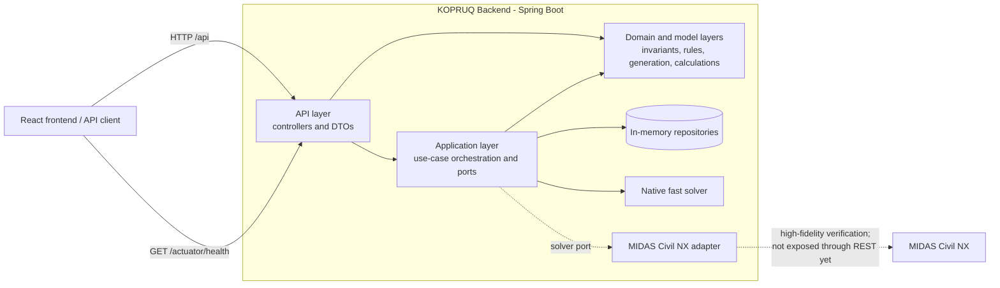
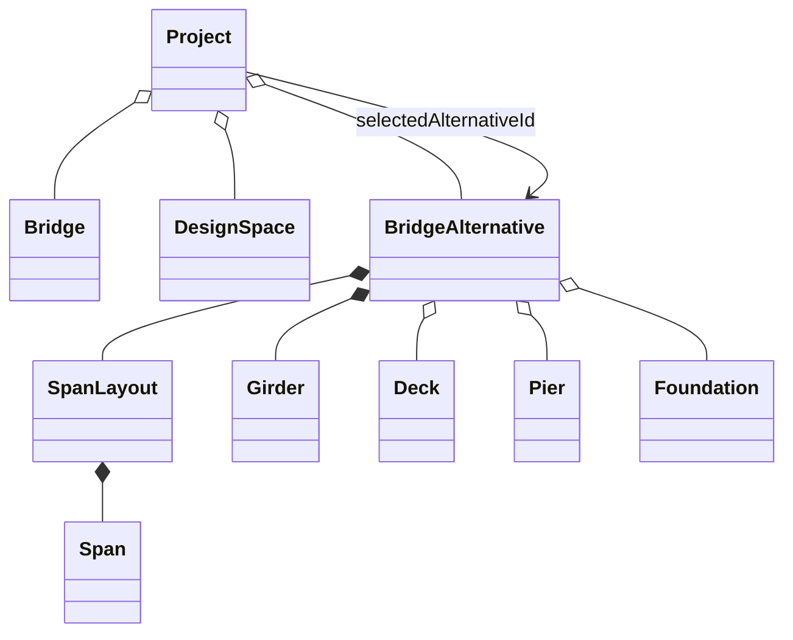
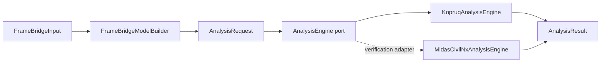

# KOPRUQ Backend

The KOPRUQ backend is the deterministic engineering core and REST API of the
Computational & Generative Bridge Design platform. It models bridge and site
data, generates traceable alternatives, resolves approved engineering inputs,
and runs solver-independent structural analyses.

The backend is intentionally a **single-module Spring Boot modular monolith**.
Business domains are isolated by Java package boundaries and architecture
tests, while external formats and solvers enter only through adapters.

> Engineering values are never invented by the application. Inputs, code
> values, provenance, validation results, and unsupported states remain
> explicit and auditable.

## Contents

- [Architecture](#architecture)
- [Package structure](#package-structure)
- [Technology stack](#technology-stack)
- [Domain model](#domain-model)
- [Project workflow](#project-workflow)
- [REST API](#rest-api)
- [Running locally](#running-locally)
- [Testing](#testing)
- [Current limitations](#current-limitations)

## Architecture



The dependency direction is:

```text
engineering domain -> engineering rules -> calculation / solver
                   -> results -> visualization -> AI explanation
```

The bridge, rules, generative, and analysis models do not depend on MIDAS,
ALLPLAN, SCIA, Three.js, or a vendor file format. LandXML and MIDAS-specific
concepts remain inside their adapter boundaries.

### Layering rules

- `api` contains controllers and transport DTOs.
- `application` coordinates use cases and owns ports/repository interfaces.
- `domain` contains framework-free algorithms and domain services.
- `model` owns domain data and invariants.
- `enums` contains domain vocabulary.
- `infra` contains adapters such as in-memory repositories and solver clients.
- `shared` contains cross-cutting configuration, validation, and the common
  error contract.
- Spring may be used in `api`, `application`, `infra`, and `shared.config`.
  The `domain` and `model` packages remain Spring-free.
- Package dependencies and controller placement are enforced by
  `com.kopruq.architecture.ArchitectureTests`.

## Package structure

```text
com.kopruq
|-- KopruqApplication.java
|-- geometry
|   `-- model             # Coordinates and points
|-- alignment
|   |-- api               # Alignment sampling endpoints
|   |-- application       # Sampling use case
|   |-- domain            # Chainage sampling
|   `-- model             # Horizontal alignment and vertical profile
|-- terrain
|   |-- api               # XYZ import, mesh, diagnostics, elevation
|   |-- application       # Import/read use cases and repository port
|   |-- domain            # Parsing, triangulation support, TIN query
|   |-- model             # Solver/rendering-independent TerrainModel
|   `-- infra             # In-memory terrain repository
|-- landxml
|   |-- api               # Inspect/import/profile endpoints
|   |-- application       # Import transaction and read use cases
|   |-- domain            # StAX parser and anti-corruption mappers
|   |-- model             # LandXML import DTOs
|   `-- infra             # In-memory import repository
|-- layout
|   |-- api               # Layout-generation endpoint
|   |-- domain            # BridgeLayoutEngine
|   `-- model             # Site, design space, candidates, constraints
|-- bridge
|   |-- api               # Kernel-state request mapping
|   `-- model             # Canonical solver-independent bridge model
|-- rules
|   |-- domain            # EngineeringRule and RuleEngine
|   `-- model             # Traceable evaluation results
|-- generative
|   |-- api               # Structural-alternative endpoint
|   |-- domain            # Deterministic generation and rule evaluation
|   `-- model             # EvaluatedAlternative
|-- loads
|   |-- api               # Traffic, wind, seismic, temperature endpoints
|   |-- application       # Traffic-load use case
|   |-- domain            # Deterministic load services
|   `-- model             # Inputs, results, provenance
|-- materials
|   |-- api               # Concrete material lookup
|   `-- domain            # Approved concrete properties/classes
|-- analysis
|   |-- api               # Fast Solver endpoint and report DTOs
|   |-- application       # AnalysisEngine port and FastSolverService
|   |-- domain            # Frame-bridge model construction
|   |-- model             # Solver-independent analysis model
|   `-- infra
|       |-- nativeengine  # Linear-elastic 3D direct-stiffness solver
|       `-- midas         # MIDAS Civil NX adapter
`-- shared
    |-- config            # Bean wiring, CORS, correlation IDs
    |-- exception         # One REST error contract
    `-- validation        # Shared request-field validation
```

## Technology stack

| Component | Technology |
| --- | --- |
| Runtime | Java 21 |
| Application framework | Spring Boot 3.5.16 / Spring Web MVC |
| Spatial geometry | JTS 1.20.0 |
| JSON | Jackson |
| Build | Maven, single `jar` module |
| Tests | JUnit 5 and Spring Boot Test |
| Health endpoints | Spring Boot Actuator |
| Persistence | In-memory repositories only; no database dependency yet |

## Domain model

All internal engineering dimensions use explicit SI-oriented names such as
`lengthM`, `forceKn`, and `elasticModulusKnPerM2`. API records are transport
views; they do not replace the domain model.

### Bridge kernel



| Model | Responsibility |
| --- | --- |
| `Project` | Mutable project/session aggregate containing the bridge, design space, generated alternatives, and selected alternative. Project persistence is not implemented yet. |
| `Bridge` | Fixed bridge facts: `bridgeName`, `totalLengthM`, and `deckWidthM`. |
| `DesignSpace` | Engineer-supplied ranges for spans, girders, slab, pier dimensions, and the deterministic girder-depth search step. |
| `BridgeAlternative` | One solver-independent configuration identified by UUID. It requires a `SpanLayout` and `Girder`; deck, pier, and foundation may remain unsized. |
| `SpanLayout` / `Span` | Ordered spans and their total length. |
| `Girder` | Girder count, depth, and spacing for the initial precast-girder scope. |
| `Deck` | Slab thickness. |
| `Pier` | Pier diameter, height, and an engineer-defined free-text type. |
| `Foundation` | `SPREAD` or `PILE`; pile count and diameter are represented only for pile foundations. |

### Geometry, alignment, terrain, and LandXML

| Package | Key models | Responsibility |
| --- | --- | --- |
| `geometry` | `CoordinateSystem`, `Point3D` | Coordinate identity and double-precision engineering coordinates. A CRS is labelled explicitly and never guessed. |
| `alignment` | `Alignment`, `HorizontalElement`, `StraightElement`, `CurveElement`, `ChainagePosition`, `VerticalProfile`, `Pvi` | Horizontal chainage/offset-to-XYZ conversion, reverse projection, circular arcs, and imported vertical profiles. Transition curves are not implemented. |
| `terrain` | `TerrainModel`, `TerrainTriangle`, `TerrainBoundary`, `TerrainBreakline`, `TerrainSource` | Authoritative TIN geometry, bounds, local render origin, import diagnostics, version, and status. Elevation queries use the containing triangle rather than nearest-point Z. |
| `landxml` | `LandXmlDocument`, `LandXmlSurface`, `LandXmlAlignment`, `LandXmlProfile`, `LandXmlImportResult` | Anti-corruption import DTOs. Valid source points and faces are preserved; the selected data is mapped into canonical terrain/alignment models. |

`TerrainModel` remains independent of LandXML and frontend rendering. The
backend retains real coordinates in doubles; mesh endpoints subtract one
centralized `localOrigin` for rendering.

### Site and bridge layout

| Model | Responsibility |
| --- | --- |
| `BridgeSite` | A candidate crossing interval along an alignment. |
| `LayoutDesignSpace` | Allowed span lengths/counts and deterministic C1/span search steps. |
| `NoPierZone` | Current LAYOUT-P01 chainage-based no-pier constraint. It is intentionally narrower than the future 3D constraint-volume model. |
| `AbutmentCandidate` | Candidate C1 or C2 chainage. |
| `PierCandidate` | Candidate pier chainage, feasibility, and rejection reasons. |
| `ConstraintCheckResult` | Trace of a constraint evaluation for a candidate pier. |
| `BridgeLayoutAlternative` | C1/C2, piers, spans, bridge length, feasibility, and constraint results. |

`BridgeLayoutEngine` returns both feasible and rejected alternatives so that a
design is auditable rather than silently filtered.

### Rules and generative design

| Model/service | Responsibility |
| --- | --- |
| `EngineeringRule` | Port for an explicitly approved rule with stable identity and description. |
| `RuleEvaluation` / `RuleOutcome` | Pass/fail result and reason for one rule. |
| `RuleEngineResult` | Overall feasibility plus all traceable rule outcomes. |
| `AlternativeGenerator` | Deterministically enumerates span/girder alternatives from `Bridge` and `DesignSpace`. |
| `EvaluatedAlternativeGenerator` | Applies every registered rule to every generated alternative in generation order. |

The rule infrastructure is active, but no real engineering rule has been
approved and registered yet. Therefore generated structural alternatives are
currently feasible unless input/generation invariants reject the request.

### Loads and material provenance

| Model | Responsibility |
| --- | --- |
| `CarriagewayInput` | Derives carriageway width from deck width minus left/right walkways. |
| `NotionalLane` / `NotionalLaneResult` | Generated lane geometry and remaining-area width. |
| `Lm1Parameters` / `LaneFactor` | LM1 tandem-system and UDL parameters. |
| `ParameterValue<T>` | Value, provenance, and code-default value. Provenance is `CODE_DEFAULT`, `NATIONAL_ANNEX`, or `PROJECT_OVERRIDE`. |
| `TrafficLoadGroup` | Architecture for EN 1991-2 compatible action groups. Groups are not EN 1990 load combinations. |
| `WindRequest/Result`, `SeismicSpectrumRequest/Result`, `UniformTemperatureRequest/Result` | Environmental-load request/result contracts. Missing or unapproved parameters remain explicit. |

LM2 is not calculated, and traffic-group membership is returned as
`NOT_DEFINED` until validated engineering rules are supplied.

### Solver-independent analysis



| Model | Responsibility |
| --- | --- |
| `AnalysisRequest` | Nodes, beam elements, elastic links, materials, sections, supports, load cases, self-weight, and uniform element loads. |
| `AnalysisSection` | Sealed section family: solid rectangle, solid circle, and I-section. |
| `AnalysisMaterial` | Solver-neutral material properties with explicit units and `MaterialKind`. |
| `BoundaryCondition` | Six translational/rotational restraints at a node. |
| `ElasticLinkElement` | Global-axis translational and rotational spring stiffnesses for bearings. |
| `AnalysisJob` / `AnalysisResult` | Job status plus reactions, displacements, and an optional failure message. |
| `FrameBridgeInput` / `FrameBridgeModel` | Validated portal-frame bridge input and its solver-ready model/report labels. |

The native engine performs linear-elastic 3D direct-stiffness analysis. The
MIDAS adapter implements the same port, but full REST execution, result
association, and post-selection verification workflow are not implemented.

## Project workflow

### Product workflow

```mermaid
flowchart LR
    Project[Project]
    Site[Site / alignment / terrain]
    Layout[Bridge layout generation]
    Structure[Structural alternatives]
    Rules[Engineering rules]
    Fast[Native fast analysis]
    Evaluate[Evaluate and compare]
    Optimize[Multi-objective optimization]
    Select[Engineer selects]
    Verify[High-fidelity verification]
    Deliver[BIM / drawings / report]

    Project --> Site --> Layout --> Structure --> Rules --> Fast --> Evaluate
    Evaluate -. future .-> Optimize
    Evaluate --> Select
    Optimize -. future .-> Select
    Select -. P07/future .-> Verify
    Verify -. future .-> Deliver
```



The authoritative hierarchy is **site before layout, layout before structural
generation, and engineering calculation before visualization or AI
explanation**. Bridge length, abutment locations, piers, and span arrangement
are design variables rather than merely typed constants.

### Implemented backend flows

#### 1. Terrain and LandXML intake

1. Inspect a LandXML file without storing it using
   `POST /api/landxml/inspect`.
2. The engineer selects the surface and optional alignment.
3. Import with explicit coordinate order using `POST /api/landxml/import`.
4. The mapper preserves valid source TIN topology and stores canonical
   `TerrainModel` and import data in shared in-memory repositories.
5. Read the mesh, diagnostics, elevation, alignment samples, or longitudinal
   profile through their GET endpoints.

Plain XYZ terrain can instead enter through `POST /api/terrain/import`.

#### 2. Layout generation

1. Supply one straight alignment, bridge-site interval, no-pier zones, and
   layout search ranges to `POST /api/layout/generate`.
2. `BridgeLayoutEngine` enumerates candidate C1/C2 and uniform-span layouts.
3. Candidate piers are checked against every no-pier zone.
4. Feasible and rejected alternatives are returned with rejection evidence.

#### 3. Structural generation and rule evaluation

1. Map the nine kernel fields into `Bridge` and `DesignSpace` with
   `POST /api/kernel-state`.
2. Send the same request to `POST /api/alternatives`.
3. The generative engine enumerates span-layout/girder configurations.
4. Every alternative passes through `RuleEngine`; all outcomes remain
   traceable.

The seam that converts a selected layout alternative into the structural
design-space workflow is not fully automated yet.

#### 4. Fast structural analysis

1. Submit explicit geometry, material strength, loads, and bearing stiffnesses
   to `POST /api/fast-solver/solve`.
2. The model builder creates a solver-neutral portal-frame model.
3. The native engine solves reactions and displacements.
4. The response reports named support reactions, deck displacements, and an
   independent applied-load versus vertical-reaction equilibrium check.

#### 5. Loads and materials

Traffic, wind, seismic, uniform-temperature, and concrete-material endpoints
are deterministic supporting calculations. They are not yet persisted into a
project-level load model or automatically assembled into an analysis request.

## REST API

Base URL: `http://localhost:8080`

All application endpoints are under `/api`. The exact set is pinned by
`EndpointInventoryContractTest`.

### API conventions

- JSON is used unless an endpoint explicitly declares multipart or binary
  content.
- Successful calculation and query endpoints currently return `200 OK`.
- Every response carries `X-Correlation-ID`. A caller-supplied value is reused;
  otherwise the backend creates one.
- Browser origins are controlled by `kopruq.cors.allowed-origins`; the default
  is `http://localhost:5173`.
- Terrain/LandXML uploads are limited to 200 MB.
- Imports are process-local and disappear when the backend restarts.

### Bridge and generation

| Method | Endpoint | Input | Output | Purpose |
| --- | --- | --- | --- | --- |
| `POST` | `/api/kernel-state` | `KernelStateRequest` JSON | `{ bridge, designSpace }` | Validate and map the nine frontend fields into canonical bridge-domain objects. No persistence. |
| `POST` | `/api/alternatives` | `KernelStateRequest` JSON | `AlternativeRow[]` | Generate span/girder alternatives and return rule-derived feasibility. |
| `POST` | `/api/layout/generate` | `LayoutGenerationRequest` JSON | `LayoutAlternativeRow[]` | Generate feasible and rejected C1/C2, pier, and span-layout candidates. |

`KernelStateRequest`:

```json
{
  "bridgeName": "VIA-01",
  "totalLengthM": 180.0,
  "deckWidthM": 13.8,
  "minSpanM": 30.0,
  "maxSpanM": 45.0,
  "minGirderCount": 5,
  "maxGirderCount": 7,
  "minGirderDepthM": 1.6,
  "maxGirderDepthM": 2.2
}
```

`LayoutGenerationRequest`:

```json
{
  "alignmentLengthM": 1000.0,
  "siteStartChainageM": 200.0,
  "siteEndChainageM": 420.0,
  "crossingType": "Highway",
  "noPierZones": [
    {
      "id": "ROAD-01",
      "startChainageM": 295.0,
      "endChainageM": 325.0,
      "description": "Existing road clearance"
    }
  ],
  "minSpanM": 25.0,
  "maxSpanM": 45.0,
  "minSpanCount": 5,
  "maxSpanCount": 8,
  "spanLengthStepM": 0.5,
  "c1StepM": 1.0
}
```

### Alignment, terrain, and LandXML

| Method | Endpoint | Parameters/body | Output | Purpose |
| --- | --- | --- | --- | --- |
| `POST` | `/api/alignment/sample` | JSON: `startXM`, `startYM`, `endXM`, `endYM`, `stepM` | `{xM,yM,chainageM}[]` | Sample a caller-defined straight alignment. `stepM <= 0` selects the service default. |
| `GET` | `/api/alignment/{id}/sample` | Path: LandXML import `id`; query: optional `stepM=0` | `{xM,yM,chainageM}[]` | Sample an imported straight/curved alignment. |
| `POST` | `/api/terrain/import` | `multipart/form-data`: `file`, `projectId`, `coordinateSystemLabel` | `TerrainImportResponse` | Import XYZ terrain, triangulate it, and store the resulting TIN. |
| `GET` | `/api/terrain/{id}/mesh` | Path: terrain `id` | `{id,positions,indices,localOrigin}` | Return a JSON indexed mesh in local rendering coordinates. |
| `GET` | `/api/terrain/{id}/mesh.bin` | Path: terrain `id` | `application/octet-stream` | Stream the indexed terrain mesh in the backend's compact binary format. |
| `GET` | `/api/terrain/{id}/diagnostics` | Path: terrain `id`; query: `breaklines=false` | `DiagnosticLine[]` | Return local-coordinate boundaries, or breaklines when `breaklines=true`. |
| `GET` | `/api/terrain/{id}/elevation` | Query: required real-coordinate `x`, `y` | `{elevationM}` | Interpolate elevation in the containing TIN triangle; `elevationM` is `null` outside the mesh. |
| `POST` | `/api/landxml/inspect` | `multipart/form-data`: `file` | `LandXmlInspectResponse` | Parse a file and list its units, CRS status, surfaces, alignments, profiles, source metadata, and warnings without storing it. |
| `POST` | `/api/landxml/import` | `multipart/form-data`: `file`, `projectId`, `coordinateSystemLabel`, `surfaceName`, `coordinateOrder`; optional `alignmentName` | `LandXmlImportSummaryResponse` | Import the selected surface and optional alignment/profile into canonical models. |
| `GET` | `/api/landxml/{id}/profile` | Path: import `id`; query: optional `stepM=0` | `{chainageM,groundElevationM,designElevationM}[]` | Compare terrain ground elevation with the imported vertical design profile. |

`coordinateOrder` must be either `FIRST_X_SECOND_Y` or
`FIRST_Y_SECOND_X`. The API requires this choice because the backend does not
silently infer coordinate order or CRS.

Example LandXML inspection:

```bash
curl -F "file=@sample.landxml" http://localhost:8080/api/landxml/inspect
```

### Loads and materials

| Method | Endpoint | Parameters/body | Output | Purpose |
| --- | --- | --- | --- | --- |
| `GET` | `/api/materials/concrete` | Query: required `materialId`, for example `C30/37` | Concrete properties with value/unit pairs | Resolve a supported concrete class through the canonical concrete utility. Unknown IDs return 404. |
| `GET` | `/api/traffic-loads/lm1-defaults` | Query: optional `laneCount=3` | `Lm1Parameters` | Return the configured LM1 parameter structure for the requested lane count, preserving provenance and unconfirmed values. |
| `GET` | `/api/traffic-loads/load-groups` | None | `TrafficLoadGroup[]` | Return visible traffic-load-group placeholders. Membership remains `NOT_DEFINED`. |
| `POST` | `/api/traffic-loads/resolve` | `{ carriageway, lm1 }` | `{ lanes, lm1, validation }` | Generate notional lanes and resolve/validate the supplied LM1 parameters. |
| `POST` | `/api/wind-loads/resolve` | `WindRequest` JSON | `WindResult` | Resolve the implemented EN 1991-1-4 wind action path. |
| `POST` | `/api/seismic/spectrum` | `SeismicSpectrumRequest` JSON | `SeismicSpectrumResult` | Generate the implemented elastic response-spectrum result. |
| `POST` | `/api/temperature/uniform/resolve` | `UniformTemperatureRequest` JSON | `UniformTemperatureResult` | Resolve uniform temperature actions while reporting missing/unapproved parameters. |

Request shapes:

```json
{
  "carriageway": {
    "deckWidthM": 13.8,
    "leftWalkwayM": 1.0,
    "rightWalkwayM": 1.0
  },
  "lm1": {
    "tandemSystem": [],
    "udl": [],
    "remainingAreaUdl": null
  }
}
```

```json
{
  "vbMs": 25.0,
  "terrainCategory": "II",
  "zeM": 20.0,
  "deckWidthM": 13.8,
  "drefM": 2.5
}
```

```json
{
  "agR": 0.3,
  "importanceFactor": 1.0,
  "groundType": "B",
  "spectrumType": "TYPE_1"
}
```

```json
{
  "effectiveMinimumTemperatureC": -20.0,
  "effectiveMaximumTemperatureC": 40.0,
  "initialTemperatureC": 10.0
}
```

These values are examples of JSON shape only; they are not KOPRUQ design
recommendations or approved project inputs.

### Structural analysis

| Method | Endpoint | Input | Output | Purpose |
| --- | --- | --- | --- | --- |
| `POST` | `/api/fast-solver/solve` | `FastSolverRequest` JSON | `FastSolverResponse` | Build and solve a continuous-deck/portal-pier frame model using the native linear-elastic solver. |

`FastSolverRequest` fields:

| Field | Unit / rule |
| --- | --- |
| `spanLengthsM` | Metres; at least one positive span. |
| `pierHeightsM` | Metres; exactly `spanCount - 1` positive values. |
| `deckWidthM`, `deckThicknessM` | Metres; positive. |
| `sdlKnPerM` | kN/m; finite, engineer supplied. |
| `columnLongitudinalM`, `columnTransverseM`, `columnSpacingTransverseM` | Metres; positive. |
| `capBeamWidthM`, `capBeamDepthM` | Metres; positive. |
| `concreteFckMpa` | MPa; positive and used to resolve implemented concrete properties. |
| `bearingKx`, `bearingKy`, `bearingKz` | kN/m; finite, engineer supplied. |
| `bearingKrx`, `bearingKry`, `bearingKrz` | kN·m/rad; finite, engineer supplied. |

The response contains `status`, `errorMessage`, named reaction rows, named deck
displacement rows, `totalAppliedLoadKn`, and `totalReactionKn`.

### Management

| Method | Endpoint | Purpose |
| --- | --- | --- |
| `GET` | `/actuator/health` | Spring Boot health status. |
| `GET` | `/actuator/info` | Application information exposed by Actuator. |

No OpenAPI/Swagger dependency is currently configured.

### Error contract

Every `/api/**` error uses one JSON shape:

```json
{
  "timestamp": "2026-10-12T10:00:00Z",
  "status": 400,
  "error": "Bad Request",
  "code": "INVALID_REQUEST",
  "message": "Request validation failed.",
  "path": "/api/layout/generate",
  "correlationId": "b5db8fe7-0de5-4f06-a6c0-e322a6ee1ac1",
  "errors": [
    {
      "field": "minSpanM",
      "message": "must be a finite number"
    }
  ]
}
```

Common codes include `INVALID_REQUEST`, `INVALID_INPUT`,
`MALFORMED_REQUEST_BODY`, `INVALID_PARAMETER`, `INVALID_LANDXML`,
`UPLOAD_TOO_LARGE`, `UPLOAD_UNREADABLE`, `NOT_FOUND`, and
`INTERNAL_ERROR`. Internal exception messages are not exposed in 5xx responses.

## Running locally

### Prerequisites

- JDK 21
- Apache Maven 3.9+

No database or message broker is required for the current backend.

From the repository root:

```powershell
mvn -B -f backend/pom.xml package
java -jar backend/target/kopruq-backend-0.1.0-SNAPSHOT.jar
```

Or run directly with Spring Boot:

```powershell
mvn -f backend/pom.xml spring-boot:run
```

The API starts at `http://localhost:8080`.

Useful configuration properties:

| Property | Default | Purpose |
| --- | --- | --- |
| `server.port` | `8080` | HTTP port. |
| `kopruq.cors.allowed-origins` | `http://localhost:5173` | Comma-separated browser origins allowed for `/api/**`. |
| `spring.servlet.multipart.max-file-size` | `200MB` | Maximum uploaded file size. |
| `spring.servlet.multipart.max-request-size` | `200MB` | Maximum multipart request size. |
| `spring.mvc.async.request-timeout` | `120000` | Timeout in milliseconds for large streamed terrain responses. |
| `management.endpoints.web.exposure.include` | `health,info` | Exposed Actuator endpoints. |

## Testing

Run all backend tests:

```powershell
mvn -B -f backend/pom.xml test
```

Build the executable jar and run the same test suite:

```powershell
mvn -B -f backend/pom.xml package
```

The suite includes:

- domain invariants and deterministic engineering cases;
- layout and generative termination checks;
- terrain/TIN and Bentley LandXML topology tests;
- load, material, and provenance behavior;
- native solver validation and MIDAS mapping contracts;
- controller and end-to-end REST contract tests;
- exact endpoint-inventory tests;
- architecture boundary tests.

## Current limitations

- Storage is in memory; no JPA/database-backed project persistence exists.
- The layout-to-structural-alternative seam is not fully automated.
- The rule engine contains infrastructure but no approved production
  engineering rules.
- Transition curves/clothoids, terrain tiling/LOD, satellite imagery, and
  full 3D spatial constraint volumes are not implemented.
- Traffic load groups are visible but undefined; LM2 remains
  `NOT_IMPLEMENTED` and is not fabricated.
- Loads are calculated through supporting endpoints but are not yet persisted
  as a project-level load model or automatically assembled into analysis.
- MIDAS Civil NX mapping/round-trip components exist, but P07 analysis
  execution and result association are not complete or exposed through REST.
- Quantities, cost, carbon, Pareto optimization, production AI orchestration,
  additional solver adapters, and delivery/BIM workflows remain future work.

For milestone status and implementation history, see
[`../docs/roadmap.md`](../docs/roadmap.md) and
[`../docs/architecture.md`](../docs/architecture.md).
